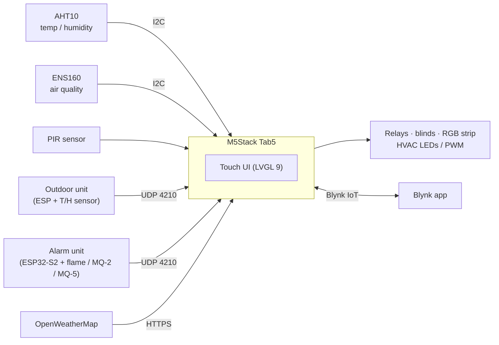
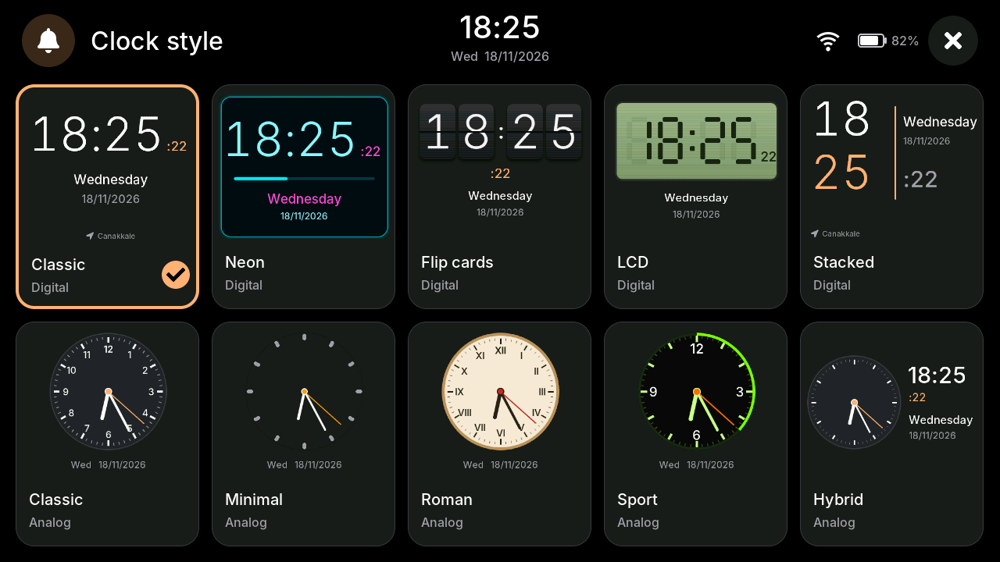
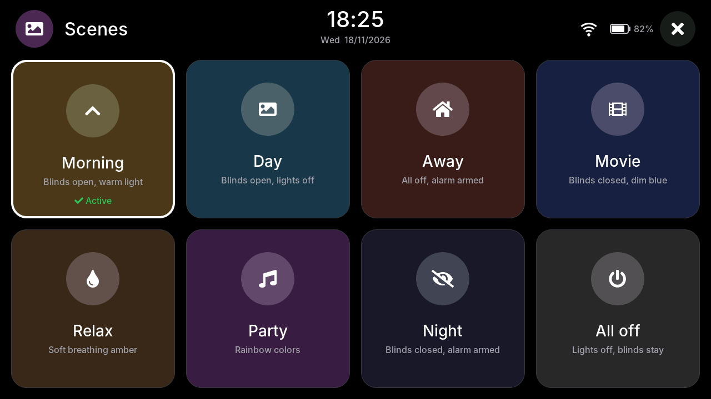
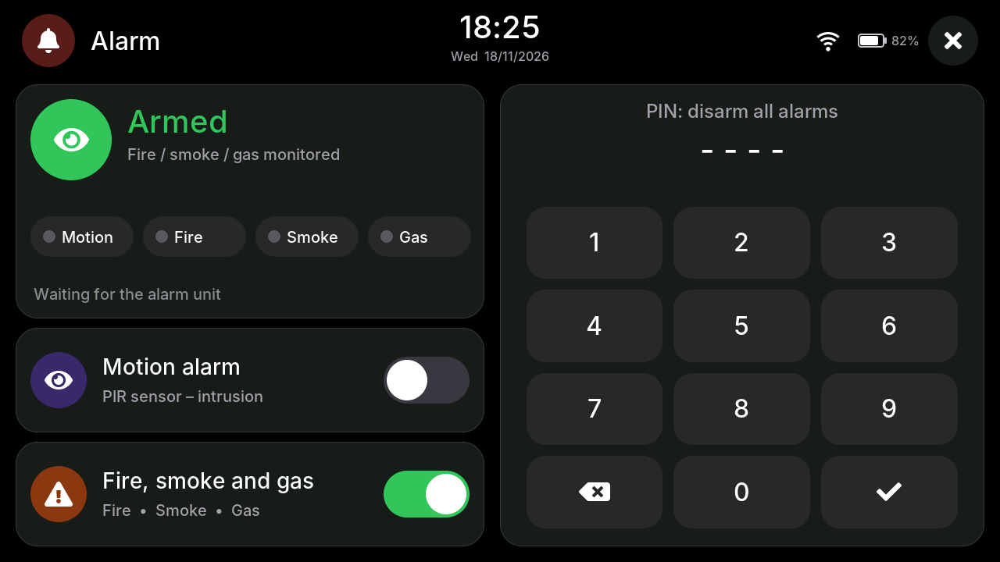
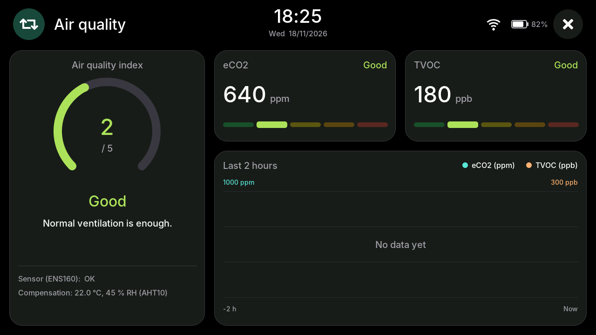
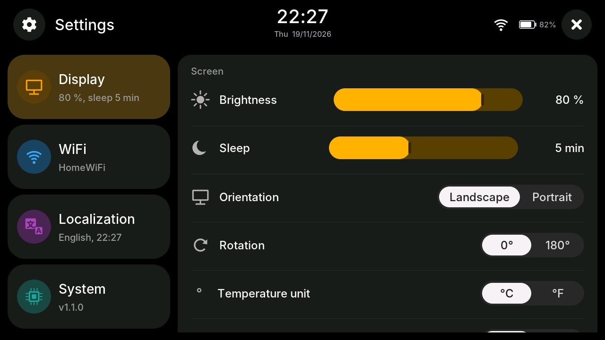
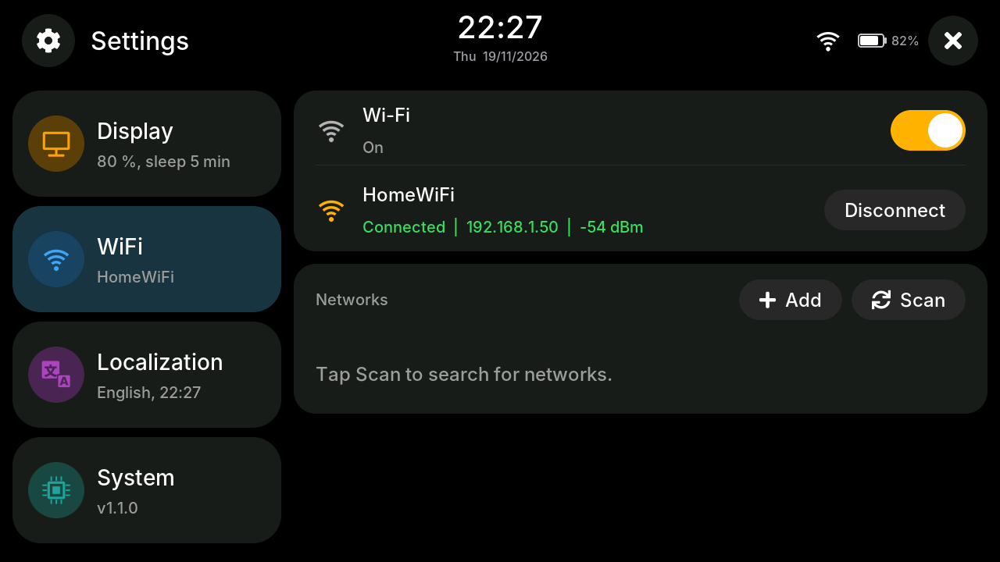
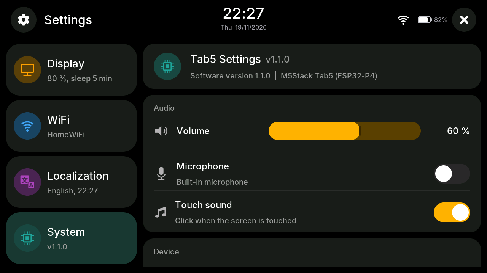
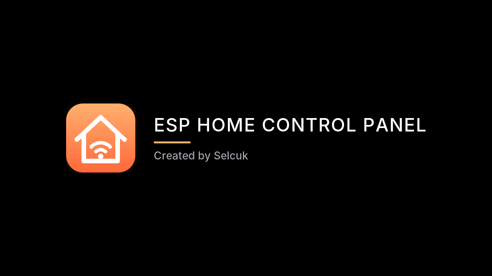

# ESP Home Control Panel

**A smart-home control panel for the M5Stack Tab5 (ESP32-P4, 5" 1280 × 720 touch screen), written in Arduino C++ with LVGL 9.**

It puts climate control, weather, blinds, RGB lighting, scenes, a two-group alarm system and indoor air quality on one touch screen. You can also control it remotely with the Blynk app. Optional wireless units add an outdoor temperature sensor and a fire / smoke / gas detector.

-blue)


*More in [Screenshots](#screenshots).*

> ### 🆕 What's new in v1.1.0
> - **10 clock styles** on the Home page: 5 digital, 5 analog. Tap the clock to choose; the choice is saved.
> - **Blinds:** each blind is shown as a window with curtains that move with the motor. Drag on the window to set the position.
> - **RGB light:** one colour wheel replaces the three R / G / B sliders.
> - **Climate (HVAC):** the main card now has the same size as the cards on the other pages.
> - **Fix:** a crash at start-up with LVGL 9.2 on the Settings page.
>
> Full list: [Changelog](#changelog)

---

## Contents

- [Overview](#overview)
- [Screenshots](#screenshots)
- [Features](#features)
- [Hardware](#hardware)
- [Software requirements](#software-requirements)
- [Quick start](#quick-start)
- [Configuration](#configuration)
- [Alarm system](#alarm-system)
- [Wireless units (UDP)](#wireless-units-udp)
- [Blynk setup](#blynk-setup)
- [Project structure](#project-structure)
- [Development](#development)
- [Troubleshooting](#troubleshooting)
- [Security and safety](#security-and-safety)
- [Changelog](#changelog)
- [Credits and license](#credits-and-license)

---

## Overview



---

## Screenshots

*Rendered from the real LVGL code in a desktop simulator (1280 × 720) with demo weather data; all images are in [`docs/`](docs/).*

| | |
|---|---|
| **Home**<br> | **Home (light theme)**<br> |
| **Clock styles**<br> | **Climate (HVAC)**<br> |
| **Weather**<br> | **Blinds**<br> |
| **RGB light**<br> | **Scenes**<br> |
| **Alarm**<br> | **Air quality**<br> |
| **Settings – Display**<br> | **Settings – Wi-Fi**<br> |
| **Settings – Localization**<br> | **Settings – System**<br> |
| **Splash screen**<br> |   |

---

## Features

| Area | Description |
|---|---|
| **Home** | Clock and date in one of 10 styles (5 digital, 5 analog): tap the clock to choose, the choice is saved. Indoor climate tile with a live HVAC animation and a *Quick* button. Outdoor temperature (one decimal) and humidity with a 3-day forecast. Tiles for blinds, RGB, air quality, scenes and alarm. |
| **HVAC** | Auto / Heat / Cool / Dry / Fan modes and a 3-speed + auto fan. Separate heating (10–30 °C) and cooling (18–30 °C) targets, plus a humidity target in Dry mode. Reads the AHT10 sensor. Stops on sensor error, over-temperature or 2 h continuous run. Monthly run time. |
| **Weather** | OpenWeatherMap: current weather, 24 h and 5-day forecast, details, air pollution, sunrise / sunset arc. |
| **Outdoor values** | From your own outdoor unit (UDP). Falls back to OpenWeatherMap after 1 min without data. |
| **Blinds** | Two motorised blinds: open / close / stop. Each blind is drawn as a window whose curtains move with the motor; drag on the window to set the position. |
| **RGB light** | PWM strip: colour wheel, brightness, presets, effects (breathe, rainbow, candle). |
| **Scenes** | Morning, Day, Away, Movie, Relax, Party, Night, All off. |
| **Alarm** | Two independent groups: **motion** (PIR) and **fire / smoke / gas** (UDP alarm unit). Each group has its own switch, and one PIN disarms everything. Siren on the Tab5 speaker, push notification through Blynk. |
| **Air quality** | ENS160: AQI 1–5, eCO2, TVOC, 2-hour chart, temperature / humidity compensation from the AHT10. |
| **Blynk IoT** | HVAC power and target, both alarm groups, *disarm all*, every sensor value, status LEDs, notifications. |
| **Settings** | Display: brightness, sleep, rotation, dark / light theme, °C / °F, motion sensor. Wi-Fi: scan, connect, keyboard. Localization: language, time zone, time / date format. System: volume, microphone, touch sound, Blynk on/off, system information, restart. |
| **System information** | Uptime, program memory, RAM / PSRAM, chip, CPU load per core, clock speed, Wi-Fi signal / link / IP / MAC, battery, version, HVAC run time this month and last month. |
| **Top bar** | Clock, Wi-Fi signal, battery level with USB / charging state. On Home it also shows motion and Blynk status. |
| **Languages** | English, Türkçe, Deutsch, Français, Español, 中文. Every text on every page is translated. |

All settings and states are stored in the Tab5 flash (NVS) and restored at power-up. All outputs are switched off at boot.

---

## Hardware

### Main unit

| Part | Notes |
|---|---|
| **M5Stack Tab5** | ESP32-P4 + ESP32-C6 (Wi-Fi 6), 1280 × 720 touch screen, battery |
| **AHT10** | Indoor temperature / humidity, I2C 0x38 |
| **ENS160** | Air quality, I2C 0x53 (same bus as the AHT10) |
| **PIR sensor** | e.g. HC-SR501 / AM312 |
| **Relay board, H-bridge, MOSFETs** | Heating / cooling relays, blind motors, RGB strip |

| Function | GPIO | Defined in |
|---|---|---|
| AHT10 + ENS160 SDA / SCL | G7 / G6 | `hvac.h` |
| Heating / cooling relay | G17 / G45 | `hvac.h` |
| Heating / cooling LED | G52 / G5 | `hvac.h` |
| Fan PWM / Dry PWM | G19 / G18 | `hvac.h` |
| PIR motion sensor | G16 | `app_data.h` |
| RGB red / green / blue (PWM) | G2 / G48 / G47 | `app_data.h` |
| Blind 1 open / close | G3 / G4 | `app_data.h` |
| Blind 2 open / close | G35 / G51 | `app_data.h` |

> ⚠️ The GPIOs use 3.3 V logic. Drive motors, LED strips and mains devices only through relay boards, an H-bridge or MOSFETs.

### Optional wireless units

| Unit | Hardware | Sketch |
|---|---|---|
| Outdoor unit | Any ESP32 / ESP8266 with a temperature / humidity sensor | your own (packet format below) |
| Alarm unit | LOLIN ESP32-S2 mini + KY-026 flame, MQ-2 smoke, MQ-5 gas sensor | [`extras/alarm_unit/alarm_unit.ino`](extras/alarm_unit/alarm_unit.ino) |

---

## Software requirements

**Arduino IDE 2.x** and **esp32 by Espressif 3.1 or newer**.

| Board setting | Value |
|---|---|
| Board | M5Tab5 (or ESP32P4 Dev Module) |
| PSRAM | Enabled |
| Flash size | 16 MB |
| Partition scheme | app partition of **at least 4 MB** (the fonts for six languages need ~1 MB) |

| Library (Library Manager) | Version |
|---|---|
| M5Unified (+ M5GFX) | latest |
| **lvgl** | **9.2.x** (not 8.x) |
| ArduinoJson | 7.x |
| Adafruit AHTX0 (+ Adafruit BusIO, Adafruit Unified Sensor) | latest |
| DFRobot_ENS160 | latest |
| Blynk (Volodymyr Shymanskyy) | 1.3+ |

> 💡 If another library offers to install its dependencies and that would replace LVGL 9 with 8.x, choose **"Install without dependencies"**.

---

## Quick start

1. Download or clone the repository. The sketch folder must have the same name as the `.ino` file (e.g. `main/main.ino`).
2. Copy **`lv_conf.h`** to `Documents/Arduino/libraries/`, next to the `lvgl` folder.
3. Enter your settings (see [Configuration](#configuration)).
4. Select the board settings above, then compile and upload.
5. On the Tab5 open **Settings → Wi-Fi** to choose a network if you did not set a default one.

---

## Configuration

| File | Settings |
|---|---|
| `app_data.h` | `DEF_OWM_API_KEY` (free key from [openweathermap.org](https://openweathermap.org/api)), `DEF_CITY`, `DEF_LATITUDE`, `DEF_LONGITUDE`, `DEF_ALARM_PIN` (default `1234`), optional `DEF_WIFI_SSID` / `DEF_WIFI_PASS`, pins |
| `hvac.h` | HVAC and sensor pins, relay / LED active level |
| `blynk.h` | `BLYNK_TEMPLATE_ID`, `BLYNK_TEMPLATE_NAME`, `BLYNK_AUTH_TOKEN` (Blynk stays off while the token is a placeholder) |
| `udp_th.h` | Static IP of the Tab5, outdoor unit id / port, outdoor value source |
| `udp_alarm.h` | Alarm unit id / port, offline time |

---

## Alarm system

The Alarm page has two **independent** groups:

| Group | Triggered by | Switch on the Tab5 | Blynk |
|---|---|---|---|
| **Motion alarm** | PIR sensor | Alarm page | V11 |
| **Fire, smoke and gas** | alarm unit (`fire`, `smoke`, `gas`) | Alarm page | V18 |

- You can keep fire / smoke / gas armed while you are at home and the motion alarm is off.
- Switching a group **on** needs no PIN.
- Switching alarms **off** needs the PIN on the keypad. One PIN entry disarms **all** groups and stops the siren. In Blynk, **V19 – Disarm all** does the same.
- When an alarm goes off:
  - the Tab5 opens the Alarm page, blinks red and sounds the siren;
  - the page names the cause (e.g. *Smoke alarm!*) and shows the live state of every detector;
  - Blynk receives a push notification with the cause.
- Other sensors can raise an alarm from your own code:

```cpp
#include "ui.h"
ui_alarm_trigger("Front door");   // opens the Alarm page, starts the siren, notifies Blynk
```

---

## Wireless units (UDP)

Both units send small JSON packets to the Tab5 on UDP port **4210**. The Tab5 uses the static address **192.168.1.50** on every network (`UDP_USE_STATIC_IP 1` in `udp_th.h`). Adapt `UDP_LOCAL_IP`, `UDP_GATEWAY`, `UDP_SUBNET` and `UDP_DNS` to your network, or set `UDP_USE_STATIC_IP 0` for DHCP.

### Outdoor unit

```json
{"id":"s2mini","seq":12,"t":23.45,"h":48.20}
```

- Only packets with `UDP_EXPECTED_ID` are accepted.
- Home shows the outdoor unit values with a green *Outdoor unit* label.
- After **1 minute** without a packet, Home shows OpenWeatherMap values with an orange label. It switches back as soon as a packet arrives. See `UDP_STALE_MS`, `OUTDOOR_USE_UDP` and `OUTDOOR_FALLBACK_OWM`.
- Your code can read both sources at any time: `g_outdoor.udp_temp / udp_hum` and `g_outdoor.owm_temp / owm_hum`.

### Fire / smoke / gas alarm unit

```json
{"id":"s2mini_alarm","seq":7,"fire":0,"smoke":1,"gas":0}
```

- Only packets with `UDP_ALARM_ID` (`"s2mini_alarm"`) are accepted. Values can be `0 / 1` or `false / true`.
- The unit sends a packet on every change and every 10 s as a heartbeat. If no packet arrives for 90 s, the Alarm page shows *Alarm unit not responding*.
- The ready-made sketch [`extras/alarm_unit/alarm_unit.ino`](extras/alarm_unit/alarm_unit.ino) contains wiring, warm-up, debouncing and calibration notes. Open it as a separate sketch for the LOLIN S2 mini and enter your Wi-Fi details and the Tab5 IP at the top.

| Sensor | Supply | Output → ESP32-S2 mini |
|---|---|---|
| KY-026 flame | 3V3 | DO → GPIO 7 |
| MQ-2 smoke | 5 V | AO → divider (10 kΩ / 20 kΩ) → GPIO 3 |
| MQ-5 gas | 5 V | AO → divider (10 kΩ / 20 kΩ) → GPIO 5 |

> ⚠️ The MQ modules output up to 5 V. Always use the voltage divider, and never connect their DO pins directly to the ESP32-S2.

---

## Blynk setup

In [Blynk.Console](https://blynk.cloud) create a template with the datastreams below. Then copy the template id, the template name and the device auth token into `blynk.h`.

**Climate**

| Pin | Name | Type | Range | Direction | Widget |
|---|---|---|---|---|---|
| V0 | HVAC power | Integer | 0–1 | app ↔ device | Switch |
| V1 | Target down | Integer | 0–1 | app → device | Button (push) |
| V2 | Target up | Integer | 0–1 | app → device | Button (push) |
| V3 | HVAC target | Double | 10–30 °C | device → app | Value / Gauge |
| V4 / V5 | Indoor temperature / humidity | Double | °C / % | device → app | Value / Gauge |
| V6 / V7 | Outdoor temperature / humidity | Double | °C / % | device → app | Value / Gauge |
| V8 / V9 / V10 | HVAC on / heating / cooling LED | Integer | 0–255 | device → app | LED |

**Alarm**

| Pin | Name | Type | Range | Direction | Widget |
|---|---|---|---|---|---|
| V11 | Motion alarm on | Integer | 0–1 | app ↔ device | Switch |
| V12 | Motion alarm armed LED | Integer | 0–255 | device → app | LED |
| V13 | Alarm ringing LED | Integer | 0–255 | device → app | LED |
| V18 | Fire / smoke / gas alarm on | Integer | 0–1 | app ↔ device | Switch |
| V19 | Disarm all | Integer | 0–1 | app → device | Button (push) |
| V20 / V21 / V22 | Fire / smoke / gas LED | Integer | 0–255 | device → app | LED |
| V23 | Fire / smoke / gas armed LED | Integer | 0–255 | device → app | LED |
| V24 | Alarm text | String | – | device → app | Label |

**Air quality**

| Pin | Name | Type | Range | Direction | Widget |
|---|---|---|---|---|---|
| V14 | Air quality index | Integer | 1–5 | device → app | Value / Gauge |
| V15 | eCO2 | Integer | 400–5000 ppm | device → app | Value / Chart |
| V16 | TVOC | Integer | 0–3000 ppb | device → app | Value / Chart |
| V17 | Air quality text | String | – | device → app | Label |

**Notification:** under *Events & Notifications*, add an event with the code **`alarm`** and enable push notifications. Each alarm sends one notification with its cause.

Notes:
- Temperatures are always sent in °C.
- Changes made in the app are saved on the Tab5 exactly like changes made on the screen.
- Blynk can be switched off in **Settings → System**.

---

## Project structure

| File | Purpose |
|---|---|
| `main.ino` | Display / touch driver, global `AppData g_data`, calls `ui.init()` |
| `ui.h / ui.cpp` | Page switching, data storage, time, PIR, alarm logic, battery state |
| `menu.*` · `splash.*` | Common top bar · start-up screen |
| `home.*` `clock.*` `weather.*` `hvac.*` `lights.*` `rgb.*` `scene.*` `alarm.*` `aq.*` `settings.*` | One file pair per page; all LVGL code of a page lives in its `.cpp` |
| `blynk.*` | Blynk IoT link (own FreeRTOS task, no LVGL code) |
| `udp_th.*` | Outdoor unit receiver and outdoor value selection |
| `udp_alarm.*` | Fire / smoke / gas alarm unit receiver |
| `sysinfo.*` | CPU load, monthly HVAC run time |
| `theme.*` | Dark / light theme (`ui_col()`) |
| `lang.*` · `fonts_ui.c` · `*_icons.c` | Translations, fonts and icons (generated) |
| `app_data.h` · `lv_conf.h` | Global data structure, defaults, pins · LVGL configuration |
| `tools/` | Python generators for translations, fonts and icons |
| `extras/alarm_unit/` | Sketch for the fire / smoke / gas alarm unit (not compiled with the panel) |
| `docs/` | Screenshots of every page (used by this README) |
| `CHANGELOG.md` | Version history |

---

## Development

**Add or change texts**

1. Edit `tools/strings.py`. Each text is one line containing all six languages.
2. Run from the sketch folder:
   ```bash
   python3 tools/make_lang.py
   python3 tools/make_fonts.py
   ```
   This needs Python 3 with **Pillow** and **fontTools**, plus the **Inter** and **Noto Sans CJK** font files (paths at the top of `make_fonts.py`).

**Rules**
- Each page keeps its LVGL code in its own `.cpp`.
- Background modules (`blynk`, `udp_*`, `sysinfo`) contain no LVGL calls.
- Everything that touches the UI or the HVAC runs in the LVGL thread.

---

## Troubleshooting

| Problem | Solution |
|---|---|
| Hundreds of errors such as `lv_button_create was not declared` | LVGL 8 is installed. Install **lvgl 9.2.x** and keep only one `lvgl` folder. |
| Sketch too big | Choose a partition scheme with ≥ 4 MB app space. |
| No weather data | Check the API key in `app_data.h` (new keys can take up to 2 h to activate) and the status line on the Weather page. |
| No internet with the static IP | Your router uses another address range. Adapt `udp_th.h` or set `UDP_USE_STATIC_IP 0`. |
| No outdoor values / alarm unit offline | Check the sender's target IP, port and `id`. Set `UDP_DEBUG 1` to print every packet on the serial monitor. |
| False smoke / gas alarms | Let the MQ sensors burn in (24–48 h), then raise `MQ2_ALARM_MV` / `MQ5_ALARM_MV` in the alarm unit sketch. |
| Blynk icon stays grey | The token in `blynk.h` is not set, or Blynk is switched off in Settings → System. |

---

## Security and safety

- **Do not commit real credentials.** Keep placeholders in `app_data.h` (Wi-Fi, OpenWeatherMap key), `blynk.h` (auth token) and `extras/alarm_unit/alarm_unit.ino` (Wi-Fi). If a key was ever published, regenerate it.
- Change the default alarm PIN `1234`.
- This project switches relays, motors and heating / cooling devices. You build and use the hardware at your own risk. Mains-voltage work must be done by a qualified person.
- The flame / smoke / gas sensors are hobby modules. They **do not replace certified smoke and gas detectors**.

---

## Changelog

The version is shown on the Settings → System page and in the system information window (`SETTINGS_VERSION` in `settings.h`). Details: [CHANGELOG.md](CHANGELOG.md).

### v1.1.0 — 2026-11-18

**New**
- **Clock styles** (`clock.cpp`): tap the Home clock to open a page with 10 styles, each shown live.
  - Digital: *Classic*, *Neon*, *Flip cards*, *LCD* (7-segment) and *Stacked*.
  - Analog: *Classic*, *Minimal*, *Roman*, *Sport* (seconds ring) and *Hybrid* (dial + digital time).
  - The selected style is saved in NVS (namespace `clock`) and kept after a restart.
  - Every style follows the 12 / 24 h and date format settings.
- **Screenshots** of every page in [`docs/`](docs/) and a gallery in this README.

**Changed**
- **Blinds page:** the position slider is replaced by a window animation.
  - The curtains follow the real motor position.
  - Dragging on the window (away from the centre = more open) sets a new target, shown by two white marks.
- **RGB light page:** the three R / G / B sliders are replaced by one colour wheel.
  - Angle = colour, distance from the centre = saturation.
  - A marker, a colour sample and the hex code show the selected colour.
  - Presets, effects and Blynk work as before.
- **Climate (HVAC) page:** the main card now runs from y = 108 to y = 700 like the cards on the other pages, and every element was re-positioned with even spacing.
- Software version **1.1.0**.

**Fixed**
- **Settings start-up crash on LVGL 9.2:** the dark / light theme buttons were styled before they were created. Newer LVGL versions ignored this silently.

**Upgrade notes**
- No setting is reset. The clock style uses its own NVS namespace.
- New files: `clock.cpp` and `clock.h`. The translations and fonts were regenerated.

### v1.0.0

First public version.
- **Home dashboard:** clock, indoor climate, weather, blinds, RGB light, air quality, scenes and alarm.
- **Climate (HVAC):** Auto / Heat / Cool / Dry / Fan modes, Quick mode, sensor and over-temperature safety, monthly run time.
- **Weather:** OpenWeatherMap current values, 24-hour chart, 5-day forecast, sunrise and sunset.
- **Outdoor unit (UDP):** decimal outdoor temperature; switches to OpenWeatherMap 1 minute after the last packet.
- **Blinds and RGB:** two motorised blinds; RGB light with presets and effects (breathe, rainbow, candle).
- **Scenes and alarm:**
  - Scenes for common situations.
  - Two alarm groups (motion, fire / smoke / gas); one PIN disarms all.
  - Alarm unit sketch for an ESP32-S2 mini.
- **Blynk:** switches, alarm control, LEDs and notifications, air quality values.
- **Settings:**
  - Brightness, screen sleep, rotation, dark / light theme.
  - Wi-Fi with a static IP on every network.
  - 6 languages, time zone, time and date format.
  - Volume, microphone, touch sound, Blynk on / off, restart.
  - System information window.
- **Other:** splash screen, battery and Wi-Fi status in the top bar.

---

## Credits and license

- [LVGL](https://lvgl.io) · [M5Unified / M5GFX](https://github.com/m5stack/M5Unified) · [OpenWeatherMap](https://openweathermap.org) · [Blynk IoT](https://blynk.io)
- Fonts: [Inter](https://rsms.me/inter/) and [Noto Sans CJK](https://github.com/notofonts/noto-cjk) (SIL Open Font License 1.1), Montserrat (built into LVGL)

This project is released under the **MIT License**; see [LICENSE](LICENSE). You may use, copy, modify and distribute it, also commercially, as long as the copyright notice is kept. It is provided without warranty. The libraries and fonts keep their own licenses.

---

**Created by Selcuk**
