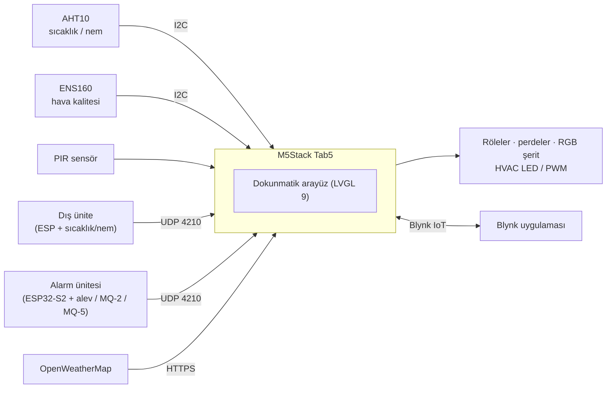

# ESP Home Control Panel

**M5Stack Tab5 (ESP32-P4, 5" 1280 × 720 dokunmatik ekran) için Arduino ve LVGL 9 ile yazılmış akıllı ev kontrol paneli.**

İklimlendirme, hava durumu, perdeler, RGB aydınlatma, sahneler, iki gruplu alarm sistemi ve iç ortam hava kalitesi tek bir dokunmatik ekranda toplanır. Panel Blynk uygulamasıyla uzaktan da kontrol edilebilir. İsteğe bağlı kablosuz üniteler dış sıcaklık sensörü ve yangın / duman / gaz dedektörü ekler.

-blue)


🇬🇧 [English: README.md](README.md)


*Daha fazlası: [Ekran görüntüleri](#ekran-görüntüleri).*

---

## İçindekiler

- [Genel bakış](#genel-bakış)
- [Ekran görüntüleri](#ekran-görüntüleri)
- [Özellikler](#özellikler)
- [Donanım](#donanım)
- [Yazılım gereksinimleri](#yazılım-gereksinimleri)
- [Hızlı başlangıç](#hızlı-başlangıç)
- [Yapılandırma](#yapılandırma)
- [Alarm sistemi](#alarm-sistemi)
- [Kablosuz üniteler (UDP)](#kablosuz-üniteler-udp)
- [Blynk kurulumu](#blynk-kurulumu)
- [Proje yapısı](#proje-yapısı)
- [Geliştirme](#geliştirme)
- [Sorun giderme](#sorun-giderme)
- [Güvenlik ve emniyet](#güvenlik-ve-emniyet)
- [Teşekkürler ve lisans](#teşekkürler-ve-lisans)

---

## Genel bakış



---

## Ekran görüntüleri

*Gerçek LVGL kodundan masaüstü simülatörde (1280 × 720) örnek hava durumu verisiyle çizildi; tüm resimler [`docs/`](docs/) klasöründe.*

| | |
|---|---|
| **Ana sayfa**<br> | **Ana sayfa (açık tema)**<br> |
| **Saat temaları**<br> | **Klima (HVAC)**<br> |
| **Hava durumu**<br> | **Perdeler**<br> |
| **RGB ışık**<br> | **Senaryolar**<br> |
| **Alarm**<br> | **Hava kalitesi**<br> |
| **Ayarlar – Ekran**<br> | **Ayarlar – Wi-Fi**<br> |
| **Ayarlar – Bölge**<br> | **Ayarlar – Sistem**<br> |
| **Açılış ekranı**<br> |   |

---

## Özellikler

| Bölüm | Açıklama |
|---|---|
| **Home** | 10 stilden birinde saat ve tarih (5 dijital, 5 analog): saate dokunarak seçilir, seçim kaydedilir. Canlı HVAC animasyonu ve *Quick* butonu olan iç ortam kutusu. Ondalıklı dış sıcaklık ve nem, 3 günlük tahmin. Perde, RGB, hava kalitesi, sahne ve alarm kutuları. |
| **HVAC** | Otomatik / Isıtma / Soğutma / Nem alma / Fan modları, 3 kademe + otomatik fan. Ayrı ısıtma (10–30 °C) ve soğutma (18–30 °C) hedefleri, nem alma modunda nem hedefi. AHT10 sensörünü okur. Sensör hatası, aşırı sıcaklık ve 2 saat kesintisiz çalışmada durur. Aylık çalışma süresini tutar. |
| **Hava durumu** | OpenWeatherMap: anlık durum, 24 saatlik ve 5 günlük tahmin, detaylar, hava kirliliği, gün doğumu / batımı yayı. |
| **Dış değerler** | Kendi dış ünitenizden (UDP) gelir. 1 dakika veri gelmezse OpenWeatherMap'e geçer. |
| **Perdeler** | İki motorlu perde: aç / kapat / dur. Her perde, perdeleri motorla birlikte hareket eden bir pencere olarak çizilir; konum pencerenin üzerinde parmakla sürüklenerek ayarlanır. |
| **RGB ışık** | PWM şerit: renk paleti (renk çemberi), parlaklık, hazır renkler, efektler (nefes, gökkuşağı, mum). |
| **Sahneler** | Sabah, Gündüz, Dışarıda, Film, Dinlenme, Parti, Gece, Hepsi kapalı. |
| **Alarm** | Birbirinden bağımsız iki grup: **hareket** (PIR) ve **yangın / duman / gaz** (UDP alarm ünitesi). Her grubun kendi anahtarı var, tek şifre hepsini kapatır. Tab5 hoparlöründen siren, Blynk ile bildirim. |
| **Hava kalitesi** | ENS160: AQI 1–5, eCO2, TVOC, 2 saatlik grafik, AHT10 ile sıcaklık / nem kompanzasyonu. |
| **Blynk IoT** | HVAC aç / kapa ve hedef sıcaklık, iki alarm grubu, *tümünü kapat*, tüm sensör değerleri, durum LED'leri, bildirimler. |
| **Ayarlar** | Ekran: parlaklık, uyku, döndürme, koyu / açık tema, °C / °F, hareket sensörü. Wi-Fi: tarama, bağlanma, klavye. Bölge: dil, saat dilimi, saat / tarih biçimi. Sistem: ses, mikrofon, dokunma sesi, Blynk aç / kapa, sistem bilgisi, yeniden başlatma. |
| **Sistem bilgisi** | Çalışma süresi, program hafızası, RAM / PSRAM, çip, çekirdek başına işlemci yükü, saat hızı, Wi-Fi sinyali / bağlantısı / IP / MAC, batarya, sürüm, bu ayki ve geçen ayki HVAC çalışma süresi. |
| **Üst bar** | Saat, Wi-Fi sinyali, USB / şarj durumlu batarya. Home'da ayrıca hareket ve Blynk durumu. |
| **Diller** | Türkçe, English, Deutsch, Français, Español, 中文. Tüm sayfalardaki tüm yazılar çevrilmiştir. |

Tüm ayarlar ve durumlar Tab5 hafızasına (NVS) kaydedilir ve açılışta geri yüklenir. Açılışta tüm çıkışlar kapalı başlar.

---

## Donanım

### Ana ünite

| Parça | Not |
|---|---|
| **M5Stack Tab5** | ESP32-P4 + ESP32-C6 (Wi-Fi 6), 1280 × 720 dokunmatik ekran, batarya |
| **AHT10** | İç ortam sıcaklık / nem, I2C 0x38 |
| **ENS160** | Hava kalitesi, I2C 0x53 (AHT10 ile aynı hat) |
| **PIR sensör** | örn. HC-SR501 / AM312 |
| **Röle kartı, H-köprü, MOSFET** | Isıtma / soğutma röleleri, perde motorları, RGB şerit |

| İşlev | GPIO | Tanım yeri |
|---|---|---|
| AHT10 + ENS160 SDA / SCL | G7 / G6 | `hvac.h` |
| Isıtma / soğutma rölesi | G17 / G45 | `hvac.h` |
| Isıtma / soğutma LED | G52 / G5 | `hvac.h` |
| Fan PWM / Nem alma PWM | G19 / G18 | `hvac.h` |
| PIR hareket sensörü | G16 | `app_data.h` |
| RGB kırmızı / yeşil / mavi (PWM) | G2 / G48 / G47 | `app_data.h` |
| Perde 1 aç / kapat | G3 / G4 | `app_data.h` |
| Perde 2 aç / kapat | G35 / G51 | `app_data.h` |

> ⚠️ Pinler 3.3 V lojik seviyesindedir. Motorları, LED şeritleri ve şebeke cihazlarını sadece röle kartı, H-köprü veya MOSFET üzerinden sürün.

### İsteğe bağlı kablosuz üniteler

| Ünite | Donanım | Program |
|---|---|---|
| Dış ünite | Sıcaklık / nem sensörlü herhangi bir ESP32 / ESP8266 | kendi programınız (paket biçimi aşağıda) |
| Alarm ünitesi | LOLIN ESP32-S2 mini + KY-026 alev, MQ-2 duman, MQ-5 gaz sensörü | [`extras/alarm_unit/alarm_unit.ino`](extras/alarm_unit/alarm_unit.ino) |

---

## Yazılım gereksinimleri

**Arduino IDE 2.x** ve **esp32 by Espressif 3.1 veya üstü**.

| Kart ayarı | Değer |
|---|---|
| Board | M5Tab5 (veya ESP32P4 Dev Module) |
| PSRAM | Enabled |
| Flash size | 16 MB |
| Partition scheme | en az **4 MB** uygulama alanı (altı dilin fontları ~1 MB yer kaplar) |

| Kütüphane (Library Manager) | Sürüm |
|---|---|
| M5Unified (+ M5GFX) | güncel |
| **lvgl** | **9.2.x** (8.x değil) |
| ArduinoJson | 7.x |
| Adafruit AHTX0 (+ Adafruit BusIO, Adafruit Unified Sensor) | güncel |
| DFRobot_ENS160 | güncel |
| Blynk (Volodymyr Shymanskyy) | 1.3+ |

> 💡 Başka bir kütüphane bağımlılıklarını kurmayı önerirse ve bu LVGL 9'u 8.x ile değiştirecekse **"Install without dependencies"** seçin.

---

## Hızlı başlangıç

1. Depoyu indirin veya klonlayın. Sketch klasörünün adı `.ino` dosyasıyla aynı olmalıdır (örn. `main/main.ino`).
2. **`lv_conf.h`** dosyasını `Belgeler/Arduino/libraries/` içine, `lvgl` klasörünün yanına kopyalayın.
3. Ayarlarınızı girin (bkz. [Yapılandırma](#yapılandırma)).
4. Yukarıdaki kart ayarlarını seçin, derleyin ve yükleyin.
5. Varsayılan bir ağ tanımlamadıysanız Tab5'te **Ayarlar → Wi-Fi** sayfasından ağınızı seçin.

---

## Yapılandırma

| Dosya | Ayarlar |
|---|---|
| `app_data.h` | `DEF_OWM_API_KEY` ([openweathermap.org](https://openweathermap.org/api) ücretsiz anahtar), `DEF_CITY`, `DEF_LATITUDE`, `DEF_LONGITUDE`, `DEF_ALARM_PIN` (varsayılan `1234`), isteğe bağlı `DEF_WIFI_SSID` / `DEF_WIFI_PASS`, pinler |
| `hvac.h` | HVAC ve sensör pinleri, röle / LED aktif seviyesi |
| `blynk.h` | `BLYNK_TEMPLATE_ID`, `BLYNK_TEMPLATE_NAME`, `BLYNK_AUTH_TOKEN` (token yer tutucu kaldıkça Blynk kapalı kalır) |
| `udp_th.h` | Tab5 sabit IP adresi, dış ünite kimliği / portu, dış değer kaynağı |
| `udp_alarm.h` | Alarm ünitesi kimliği / portu, bağlantı kopma süresi |

---

## Alarm sistemi

Alarm sayfasında birbirinden **bağımsız** iki grup bulunur:

| Grup | Tetikleyen | Tab5'teki anahtar | Blynk |
|---|---|---|---|
| **Hareket alarmı** | PIR sensör | Alarm sayfası | V11 |
| **Yangın, duman ve gaz** | Alarm ünitesi (`fire`, `smoke`, `gas`) | Alarm sayfası | V18 |

- Evdeyken hareket alarmını kapalı tutup yangın / duman / gaz alarmını açık bırakabilirsiniz.
- Bir grubu **açmak** için şifre gerekmez.
- Alarmları **kapatmak** için tuş takımına şifre girilir. Tek şifre girişi **tüm** grupları kapatır ve sireni susturur. Blynk'te **V19 – Tümünü kapat** aynı işi yapar.
- Bir alarm çaldığında:
  - Tab5 alarm sayfasını açar, ekran kırmızı yanıp söner ve siren çalar;
  - sayfada alarmın sebebi (örn. *Duman alarmı!*) ve her dedektörün anlık durumu görünür;
  - Blynk'e sebebiyle birlikte bildirim gider.
- Diğer sensörler kendi kodunuzdan alarm verebilir:

```cpp
#include "ui.h"
ui_alarm_trigger("Ön kapı");   // alarm sayfasını açar, sireni çalar, Blynk'e bildirim gönderir
```

---

## Kablosuz üniteler (UDP)

İki ünite de Tab5'e **4210** numaralı UDP portundan küçük JSON paketleri gönderir. Tab5 her ağda **192.168.1.50** sabit adresini kullanır (`udp_th.h` içinde `UDP_USE_STATIC_IP 1`). `UDP_LOCAL_IP`, `UDP_GATEWAY`, `UDP_SUBNET` ve `UDP_DNS` değerlerini kendi ağınıza göre değiştirin ya da DHCP için `UDP_USE_STATIC_IP 0` yapın.

### Dış ünite

```json
{"id":"s2mini","seq":12,"t":23.45,"h":48.20}
```

- Sadece `UDP_EXPECTED_ID` kimliğiyle gelen paketler kabul edilir.
- Home'da dış ünite değerleri yeşil *Dış ünite* yazısıyla görünür.
- **1 dakika** paket gelmezse Home turuncu yazıyla OpenWeatherMap değerlerini gösterir. Paket gelince hemen geri döner. İlgili ayarlar: `UDP_STALE_MS`, `OUTDOOR_USE_UDP`, `OUTDOOR_FALLBACK_OWM`.
- Kodunuz iki kaynağı da her zaman okuyabilir: `g_outdoor.udp_temp / udp_hum` ve `g_outdoor.owm_temp / owm_hum`.

### Yangın / duman / gaz alarm ünitesi

```json
{"id":"s2mini_alarm","seq":7,"fire":0,"smoke":1,"gas":0}
```

- Sadece `UDP_ALARM_ID` (`"s2mini_alarm"`) kimliğiyle gelen paketler kabul edilir. Değerler `0 / 1` veya `false / true` olabilir.
- Ünite her değişiklikte ve 10 saniyede bir (yaşam sinyali) paket gönderir. 90 saniye paket gelmezse alarm sayfasında *Alarm ünitesi yanıt vermiyor* yazar.
- Hazır program [`extras/alarm_unit/alarm_unit.ino`](extras/alarm_unit/alarm_unit.ino) içinde bağlantı, ısınma, parazit filtresi ve kalibrasyon notları vardır. LOLIN S2 mini için ayrı bir sketch olarak açın ve en üstte Wi-Fi bilgilerinizi ve Tab5 IP adresini girin.

| Sensör | Besleme | Çıkış → ESP32-S2 mini |
|---|---|---|
| KY-026 alev | 3V3 | DO → GPIO 7 |
| MQ-2 duman | 5 V | AO → bölücü (10 kΩ / 20 kΩ) → GPIO 3 |
| MQ-5 gaz | 5 V | AO → bölücü (10 kΩ / 20 kΩ) → GPIO 5 |

> ⚠️ MQ modüllerinin çıkışı 5 V'a kadar çıkar. Gerilim bölücüyü mutlaka kullanın ve DO pinlerini ESP32-S2'ye doğrudan bağlamayın.

---

## Blynk kurulumu

[Blynk.Console](https://blynk.cloud)'da aşağıdaki datastream'lerle bir şablon oluşturun. Ardından şablon kimliğini, şablon adını ve cihaz token'ını `blynk.h` dosyasına girin.

**İklim**

| Pin | Ad | Tür | Aralık | Yön | Widget |
|---|---|---|---|---|---|
| V0 | HVAC aç / kapa | Integer | 0–1 | uygulama ↔ cihaz | Switch |
| V1 | Sıcaklık azalt | Integer | 0–1 | uygulama → cihaz | Button (push) |
| V2 | Sıcaklık arttır | Integer | 0–1 | uygulama → cihaz | Button (push) |
| V3 | HVAC hedef | Double | 10–30 °C | cihaz → uygulama | Value / Gauge |
| V4 / V5 | İç sıcaklık / nem | Double | °C / % | cihaz → uygulama | Value / Gauge |
| V6 / V7 | Dış sıcaklık / nem | Double | °C / % | cihaz → uygulama | Value / Gauge |
| V8 / V9 / V10 | HVAC açık / ısıtma / soğutma LED | Integer | 0–255 | cihaz → uygulama | LED |

**Alarm**

| Pin | Ad | Tür | Aralık | Yön | Widget |
|---|---|---|---|---|---|
| V11 | Hareket alarmı açık | Integer | 0–1 | uygulama ↔ cihaz | Switch |
| V12 | Hareket alarmı kurulu LED | Integer | 0–255 | cihaz → uygulama | LED |
| V13 | Alarm çalıyor LED | Integer | 0–255 | cihaz → uygulama | LED |
| V18 | Yangın / duman / gaz alarmı açık | Integer | 0–1 | uygulama ↔ cihaz | Switch |
| V19 | Tüm alarmları kapat | Integer | 0–1 | uygulama → cihaz | Button (push) |
| V20 / V21 / V22 | Yangın / duman / gaz LED | Integer | 0–255 | cihaz → uygulama | LED |
| V23 | Yangın / duman / gaz kurulu LED | Integer | 0–255 | cihaz → uygulama | LED |
| V24 | Alarm yazısı | String | – | cihaz → uygulama | Label |

**Hava kalitesi**

| Pin | Ad | Tür | Aralık | Yön | Widget |
|---|---|---|---|---|---|
| V14 | Hava kalitesi indeksi | Integer | 1–5 | cihaz → uygulama | Value / Gauge |
| V15 | eCO2 | Integer | 400–5000 ppm | cihaz → uygulama | Value / Chart |
| V16 | TVOC | Integer | 0–3000 ppb | cihaz → uygulama | Value / Chart |
| V17 | Hava kalitesi yazısı | String | – | cihaz → uygulama | Label |

**Bildirim:** *Events & Notifications* altında kodu **`alarm`** olan bir olay ekleyin ve bildirimleri açın. Her alarm, sebebiyle birlikte bir bildirim gönderir.

Notlar:
- Sıcaklıklar her zaman °C olarak gönderilir.
- Uygulamadan yapılan değişiklikler, ekrandan yapılmış gibi Tab5 hafızasına kaydedilir.
- Blynk, **Ayarlar → System** sayfasından kapatılabilir.

---

## Proje yapısı

| Dosya | Görev |
|---|---|
| `main.ino` | Ekran / dokunmatik sürücüsü, global `AppData g_data`, `ui.init()` çağrısı |
| `ui.h / ui.cpp` | Sayfa geçişleri, veri kaydı, saat, PIR, alarm mantığı, batarya durumu |
| `menu.*` · `splash.*` | Ortak üst bar · açılış ekranı |
| `home.*` `clock.*` `weather.*` `hvac.*` `lights.*` `rgb.*` `scene.*` `alarm.*` `aq.*` `settings.*` | Her sayfa için bir dosya çifti; sayfanın tüm LVGL kodu kendi `.cpp` dosyasında |
| `blynk.*` | Blynk IoT bağlantısı (ayrı FreeRTOS görevi, LVGL kodu yok) |
| `udp_th.*` | Dış ünite alıcısı ve dış değer seçimi |
| `udp_alarm.*` | Yangın / duman / gaz alarm ünitesi alıcısı |
| `sysinfo.*` | İşlemci yükü, aylık HVAC çalışma süresi |
| `theme.*` | Koyu / açık tema (`ui_col()`) |
| `lang.*` · `fonts_ui.c` · `*_icons.c` | Çeviriler, fontlar ve ikonlar (üretilmiş) |
| `app_data.h` · `lv_conf.h` | Global veri yapısı, varsayılanlar, pinler · LVGL ayarları |
| `tools/` | Çeviri, font ve ikon üreten Python betikleri |
| `extras/alarm_unit/` | Yangın / duman / gaz alarm ünitesi programı (panelle birlikte derlenmez) |
| `docs/` | Tüm sayfaların ekran görüntüleri (bu README kullanır) |

---

## Geliştirme

**Metin ekleme / değiştirme**

1. `tools/strings.py` dosyasını düzenleyin. Her metin, altı dili de içeren tek bir satırdır.
2. Sketch klasöründe çalıştırın:
   ```bash
   python3 tools/make_lang.py
   python3 tools/make_fonts.py
   ```
   Bunun için Python 3, **Pillow** ve **fontTools** ile **Inter** ve **Noto Sans CJK** font dosyaları gerekir (yolları `make_fonts.py` başında).

**Kurallar**
- Her sayfanın LVGL kodu kendi `.cpp` dosyasında durur.
- Arka plan modüllerinde (`blynk`, `udp_*`, `sysinfo`) LVGL çağrısı yoktur.
- Arayüze ve HVAC'a dokunan her şey LVGL iş parçacığında çalışır.

---

## Sorun giderme

| Sorun | Çözüm |
|---|---|
| `lv_button_create was not declared` gibi yüzlerce hata | LVGL 8 kurulu. **lvgl 9.2.x** kurun ve yalnızca bir `lvgl` klasörü bırakın. |
| Sketch çok büyük | En az 4 MB uygulama alanı olan bir partition şeması seçin. |
| Hava durumu gelmiyor | `app_data.h` içindeki API anahtarını kontrol edin (yeni anahtarların aktifleşmesi 2 saati bulabilir) ve Weather sayfasındaki durum satırına bakın. |
| Sabit IP ile internet yok | Modeminiz farklı bir adres aralığı kullanıyor. `udp_th.h` değerlerini değiştirin veya `UDP_USE_STATIC_IP 0` yapın. |
| Dış değer yok / alarm ünitesi bağlı değil | Göndericinin hedef IP, port ve `id` değerlerini kontrol edin. Her paketi seri monitörde görmek için `UDP_DEBUG 1` yapın. |
| Yanlış duman / gaz alarmı | MQ sensörlerini 24–48 saat elektrikte bırakın, sonra alarm ünitesi programındaki `MQ2_ALARM_MV` / `MQ5_ALARM_MV` değerlerini yükseltin. |
| Blynk ikonu gri kalıyor | `blynk.h` içine token girilmemiş ya da Ayarlar → System'de Blynk kapalı. |

---

## Güvenlik ve emniyet

- **Gerçek şifreleri depoya yüklemeyin.** `app_data.h` (Wi-Fi, OpenWeatherMap anahtarı), `blynk.h` (token) ve `extras/alarm_unit/alarm_unit.ino` (Wi-Fi) dosyalarında yer tutucular kalsın. Bir anahtar yayınlandıysa yenisini oluşturun.
- Varsayılan alarm şifresi `1234`'ü değiştirin.
- Bu proje röle, motor ve ısıtma / soğutma cihazlarını kontrol eder. Donanımı kurmak ve kullanmak kendi sorumluluğunuzdadır. Şebeke gerilimiyle ilgili işleri yetkili bir kişi yapmalıdır.
- Alev / duman / gaz sensörleri hobi modülleridir ve **sertifikalı duman ve gaz dedektörlerinin yerini tutmaz**.

---

## Teşekkürler ve lisans

- [LVGL](https://lvgl.io) · [M5Unified / M5GFX](https://github.com/m5stack/M5Unified) · [OpenWeatherMap](https://openweathermap.org) · [Blynk IoT](https://blynk.io)
- Fontlar: [Inter](https://rsms.me/inter/) ve [Noto Sans CJK](https://github.com/notofonts/noto-cjk) (SIL Open Font License 1.1), Montserrat (LVGL içinde)

Bu proje **MIT Lisansı** ile yayınlanmıştır; ayrıntılar için [LICENSE](LICENSE). Telif hakkı notunu korumak şartıyla projeyi ticari amaçlar dahil kullanabilir, kopyalayabilir, değiştirebilir ve dağıtabilirsiniz. Proje garanti olmadan sunulur. Kütüphaneler ve fontlar kendi lisanslarına tabidir.

---

**Created by Selcuk**
